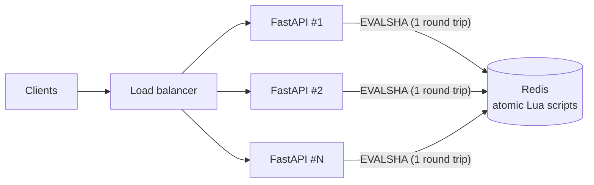

# Rate Limiter Lab


**Live demo → https://YOUR-APP.onrender.com**

A distributed rate limiter implementing the four classic algorithms on top of Redis, with a live page that fires identical traffic at all four side by side so you can watch where they disagree.

<!-- Add a screenshot or GIF of the boundary attack here: docs/demo.gif -->

## What it shows

| | |
|---|---|
| **Correctness under concurrency** | Every check is one atomic Redis Lua script, so there are no read-modify-write races, even across many app instances. |
| **Horizontal scalability** | The app is stateless. `docker compose up` runs 3 instances behind nginx sharing one Redis, and the limits stay global. |
| **Algorithm tradeoffs** | The "Boundary attack" button shows fixed window letting through **2x the limit** while sliding log holds exactly. |
| **Failure handling** | If Redis goes down the API fails open (configurable), times out after 500ms, and `/health` reports `degraded`. |
| **API design** | Standard `RateLimit-*` + `Retry-After` headers, plus a `/v1/check` endpoint so other services can use it. |
| **Interface craft** | Spring-driven, interruptible motion; feedback on press with no tap delay; a translucent floating toolbar; honours reduced-motion, reduced-transparency and high-contrast settings. No frameworks, one HTML file. |
| **Testing** | 74 tests. Every algorithm test runs against both backends, proving the Python and Lua versions decide identically. CI runs them against a real Redis. |

## Architecture



```
app/
├── main.py                  HTTP layer: endpoints, headers, fail-open policy
├── config.py                env-based settings
├── limiter/
│   ├── algorithms.py        the 4 algorithms: time math, key layout, Retry-After
│   ├── models.py            Rule, Decision
│   └── backends/
│       ├── redis_backend.py Lua scripts, one per algorithm
│       └── memory.py        same logic in Python, for dev and tests
└── static/index.html        the visual demo (vanilla JS + canvas)
```

**The split that makes this testable:** algorithms compute everything time-dependent (window boundaries, weights, refill rates) and pass `now` in. Backends only do the read-check-write step that must be atomic. With an injected clock, the tests control time exactly: no `sleep()`, no flakiness, and the whole suite runs in about 1.5 seconds.

## The algorithms

| Algorithm | Memory per client | Accuracy | Bursts | Used by |
|---|---|---|---|---|
| **Fixed window** | O(1): one counter | Up to **2x** at window edges | Edge bursts | Simple quotas |
| **Sliding log** | O(limit): a timestamp per request | Exact | None | Low limits where precision matters |
| **Sliding window counter** | O(1): two counters | ~Exact (assumes even spread in the previous window) | Smoothed | Cloudflare's approach |
| **Token bucket** | O(1): tokens + timestamp | Exact average rate | Up to capacity, by design | AWS API Gateway, Stripe |

Try **Boundary attack** on the demo: it sends `limit` requests just before a window boundary and `limit` more just after. Fixed window accepts all of them. Both sliding algorithms reject the second burst. Token bucket allows a few extra because tokens refilled in the meantime, which is the correct behavior for a limiter that enforces an *average* rate.

## Design decisions & tradeoffs

**Lua scripts instead of `MULTI`/`WATCH`.** Optimistic transactions retry under contention, which is exactly when a rate limiter is busiest. A script runs atomically on the server with no retries and in one round trip.

**Time comes from the app, not Redis.** Passing `now` in makes the logic deterministic and testable. The cost: app servers' clocks must agree (NTP keeps them within milliseconds, which is negligible against windows measured in seconds). The alternative is `redis.call('TIME')` inside the scripts, which removes clock-skew concerns but makes the scripts non-deterministic.

**Floats cross the Lua boundary as `%.17g` strings.** Lua numbers returned to Redis are truncated to integers. Formatting with 17 significant digits round-trips IEEE doubles exactly, which is why the memory and Redis backends agree bit for bit.

**Cluster-ready keys.** Keys look like `rl:swc:{client}:1712345670000`. The `{client}` hash tag puts all of a client's keys on one Redis Cluster shard, which the sliding window counter needs because its script reads two keys at once.

**Fail open by default.** For most APIs, briefly not rate-limiting is better than a full outage caused by the limiter. Set `FAIL_OPEN=false` for cases like login-attempt limits, where failing closed is safer.

**Every key has a TTL.** Idle clients cost nothing. Keys expire after one or two windows, and Redis runs with `allkeys-lru` as a backstop.

**Denied requests don't consume quota.** Every script checks before it increments, so a client hammering a 429 doesn't push its own reset time further out.

## Performance

Run with `k6 run loadtest/k6.js` against the 3-instance compose stack (ramps to 2,000 req/s across 500 clients).

| Metric | Result |
|---|---|
| Peak throughput | _fill in_ req/s |
| p50 / p95 / p99 latency | _fill in_ |
| Error rate (5xx) | _fill in_ |
| Hardware | _fill in_ |

## Scaling it further

What I'd change at 100x the traffic:

1. **Redis Cluster.** The hash-tagged keys already shard cleanly by client.
2. **Local pre-check.** Cache "this client is over its limit until T" in each app instance's memory, so repeat offenders never reach Redis. This trades a little accuracy for a large drop in Redis load.
3. **Batching for very hot keys.** Each instance reserves N tokens in one call instead of 1 per request, cutting Redis calls by N in exchange for slightly less precise limits.
4. **Multi-region.** A Redis per region with per-region limits, or async replication of approximate counts. Strict global limits across regions cost a cross-region round trip per request.
5. **Config as data.** Store rules per API key or plan in Redis, so limits change without a deploy.

## Running it

**Locally, no Redis needed** (uses the in-memory backend):

```bash
python -m venv .venv && source .venv/bin/activate   # Windows: .venv\Scripts\activate
pip install -r requirements-dev.txt
uvicorn app.main:app --reload
# → http://localhost:8000
```

**Full distributed setup** (3 app instances + nginx + Redis):

```bash
docker compose up --build
# → http://localhost:8080  ("Instances seen" climbs to 3)
```

**Tests:**

```bash
pytest                                      # memory + fakeredis
REDIS_TEST_URL=redis://localhost:6379 pytest  # against a real Redis
```

**Deploy (free):** push to GitHub, then on Render choose **New → Blueprint** and select the repo. `render.yaml` provisions the web service and a Redis-compatible Key Value store. The free tier sleeps after 15 minutes idle, so the first visit takes about 30s to wake up.

## API

| Endpoint | Description |
|---|---|
| `GET /api/demo/{algorithm}` | Sample endpoint protected by the default rule. 200 or 429. |
| `POST /v1/check` | `{key, algorithm, limit, window}` → `{allowed, remaining, retry_after, ...}` |
| `GET /api/algorithms` | Algorithm metadata + server time |
| `GET /health` | Backend connectivity |
| `GET /docs` | Interactive OpenAPI docs |

Configuration via environment: `REDIS_URL` (empty means in-memory), `DEFAULT_LIMIT` (10), `DEFAULT_WINDOW` (10 seconds), `FAIL_OPEN` (true).
